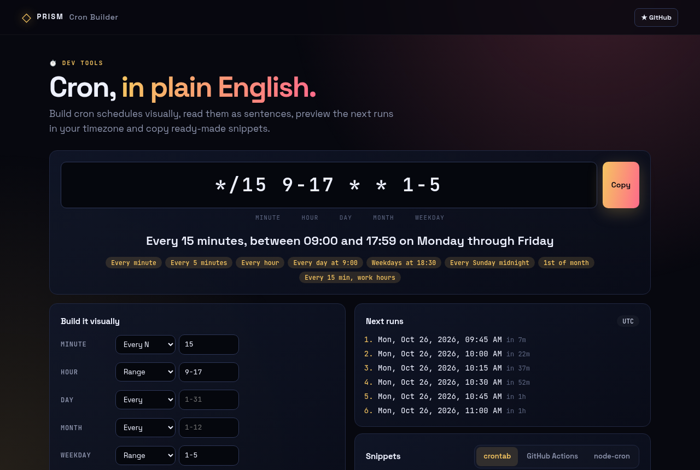
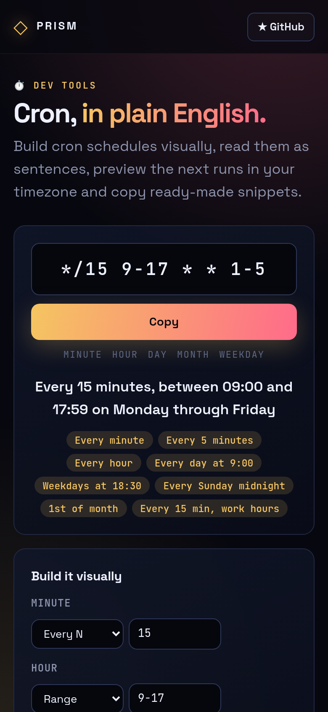

<!-- ═════════════ HEADER ═════════════ -->
<p align="center">
  
</p>

<p align="center">
  
</p>

<p align="center">
  <a href="https://github.com/krishyaa06/prism-cron-builder/actions/workflows/ci.yml"></a>
  <a href="https://krishyaa06.github.io/prism-cron-builder/"></a>
  
  
  <a href="LICENSE"></a>
</p>

<p align="center">
  
</p>


## ⚡ Overview

**Prism Cron Builder** turns cryptic five-field cron expressions into something you can actually read. Type an expression or build it field by field, and it is validated, described in plain English, and previewed with the next six run times in your local timezone. Copy snippets for crontab, GitHub Actions or node-cron.

## ✨ Features

- **Plain-English descriptions** like *At 18:30 on Monday through Friday*
- **Visual builder** for each field: every, specific, step or range
- **Next 6 runs** computed in your timezone with relative times
- Supports ranges, lists, steps, `JAN`/`MON` names and `@daily`/`@hourly` macros
- Follows the standard day-of-month **OR** day-of-week rule
- **Snippets** for crontab, GitHub Actions and node-cron
- Friendly validation errors and one-click presets

## 📸 Screenshots

<table>
  <tr>
    <td width="68%"></td>
    <td width="32%"></td>
  </tr>
</table>

## 🚀 Quick Start

**Use it online:** [https://krishyaa06.github.io/prism-cron-builder/](https://krishyaa06.github.io/prism-cron-builder/)

**Run locally:**

```bash
git clone https://github.com/krishyaa06/prism-cron-builder.git
cd prism-cron-builder
# open index.html in your browser, or serve it:
npx serve .
```

## 🛠️ Usage

| Expression | Meaning |
| --- | --- |
| `*/5 * * * *` | Every 5 minutes |
| `0 9 * * *` | Every day at 09:00 |
| `30 18 * * 1-5` | Weekdays at 18:30 |
| `0 0 1 * *` | First day of every month |
| `@weekly` | Every Sunday at midnight |

## 📁 Project Structure

```
prism-cron-builder/
├── assets/
│   ├── logo.png
│   └── logo.svg
├── css/
│   ├── app.css
│   └── prism.css
├── js/
│   ├── app.js   # UI wiring
│   ├── core.js   # parser, describer and next-run engine — tested in Node
│   └── prism.js
├── test/
│   └── core.test.js
├── .gitignore
├── LICENSE
├── README.md
├── index.html
└── package.json
```

## 🧪 Tests

```bash
npm test
```

Tests use the built-in `node:test` runner, so there is nothing to install. CI runs them on Node 20 and 22.

## 🤝 Contributing

1. Fork the repo and create a branch: `git checkout -b feature/my-idea`
2. Make your change and add a test in `test/`
3. Run `npm test` and open a Pull Request

## 🔷 Part of Prism Protocol

Prism Cron Builder is one of the open-source tools built by [Prism Protocol](https://dc.gg/prismprotocol), a tech community where young builders learn, ship and compete together.

## 👤 Author

<table>
  <tr>
    <td align="center">
      <a href="https://github.com/krishyaa06"><br><b>Soumya Bhandare</b></a><br>
      <sub>Founder @ Prism Protocol</sub>
    </td>
    <td>
      <a href="https://dc.gg/prismprotocol"></a><br>
      <a href="https://instagram.com/prism_protocol_"></a><br>
      <a href="https://x.com/krishyaa06"></a>
    </td>
  </tr>
</table>

## 📄 License

Released under the [MIT License](LICENSE).

<p align="center">
  <b>If you like this project, consider giving it a ⭐</b><br>
  <sub>"Build. Create. Compete." · Made with ⚡ by Prism Protocol</sub>
</p>


